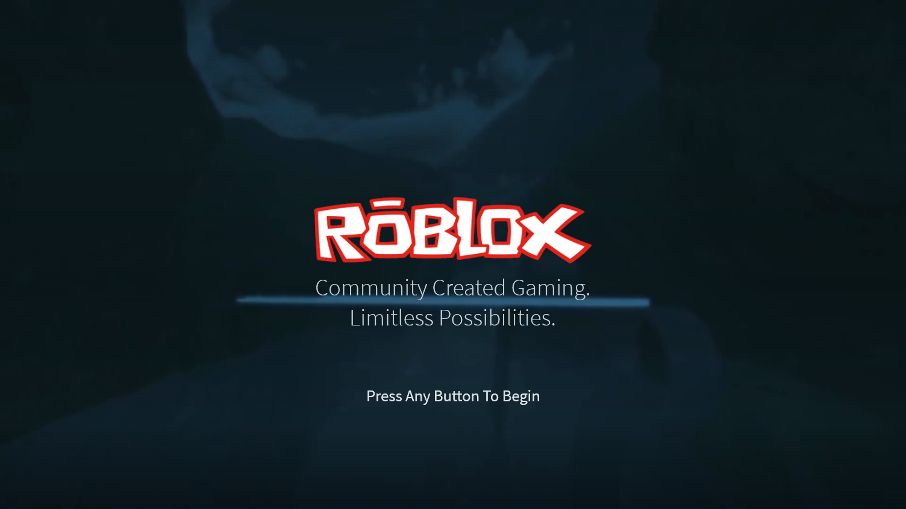
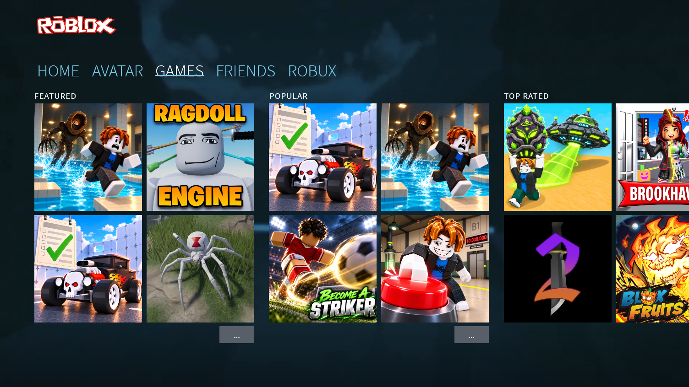
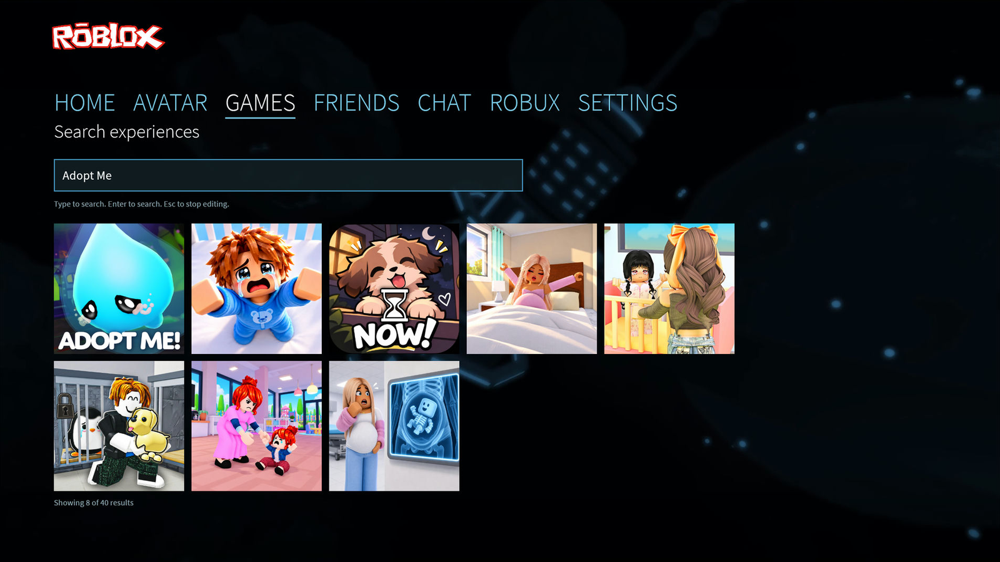
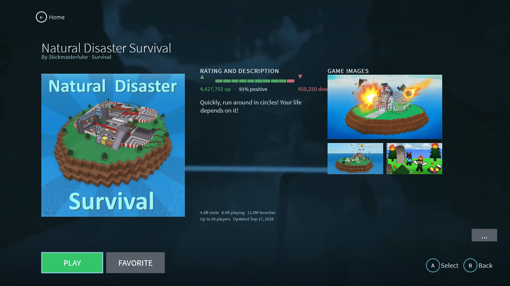

# Roblox 2016 Xbox Client

A native Linux reconstruction of the 2016 Roblox Xbox One console shell, written in Rust. It signs in to a real Roblox account, reads live catalog and social data from Roblox's public APIs, and launches real experiences through [Sober](https://vinegarhq.org/Sober/), the Android-compatible Roblox runtime for Linux.



**Status:** working prototype. Sign-in, browsing, search, and the full launch flow have been verified end to end on the release build. See [Known limitations](#known-limitations).

This is an unofficial fan project. It is not affiliated with, endorsed by, or supported by Roblox Corporation. Read the [legal and asset notice](#legal-and-asset-notice) before redistributing anything from this repository.

## Features

| Area | What it does |
|---|---|
| Shell | Title, sign-in, Home, Games, Search, Details, Favorites, Profile, Friends, Chat, Avatar, and Settings screens |
| Catalog | Live sorts, search, place details, media, votes, favorites, and square game tiles in the 2016 layout |
| Account | WebKitGTK login window, read-only Sober session import, Secret Service storage, guest browsing, and sign-out |
| Launch | Verified `roblox://` handoff to Sober, join confirmation from Sober's log, and honest crash and timeout states |
| Social | Friends and presence, friend profiles, Add Friends, and Roblox platform chat |
| Avatar | Inventory categories, platform outfits, and a full-body avatar render |
| Media | User-supplied looping background video and menu music, a generated fallback scene, and embedded UI sounds |
| Input | Keyboard, mouse, and gamepad support through `gilrs` |
| Operations | Single-instance lock, persistent app log, and a no-root install and uninstall |

The shell does not invent account data, game data, or launch results. Empty, loading, and error states are shown for the live data it fetches.

## Requirements

- Linux. The project was developed and tested on CachyOS with KDE Plasma Wayland and an NVIDIA GPU.
- Rust 1.95 or newer, with edition 2024 support.
- GTK 3 and WebKitGTK 4.1 development packages.
- `ffmpeg` for the video background.
- [Sober](https://vinegarhq.org/Sober/) from Flathub for game launches.
- A Roblox account for authenticated features. Guest browsing works without one.
- A gamepad is optional.

On Arch Linux and CachyOS:

```bash
sudo pacman -S --needed base-devel rustup gtk3 webkit2gtk-4.1 ffmpeg
rustup default stable
```

On Debian and Ubuntu, the matching development packages are usually:

```bash
sudo apt install build-essential pkg-config libgtk-3-dev libwebkit2gtk-4.1-dev ffmpeg
```

Install Rust with `rustup` if your distribution package is older than 1.95. Package names differ across distributions.

Install Sober and sign in once:

```bash
flatpak install flathub org.vinegarhq.Sober
```

## Build and run

From the project root:

```bash
cargo build --release
./target/release/roblox-2016-xbox
```

During development, `cargo run --release` starts the same build.

## Install

`install.sh` installs the app for the current user without root:

```bash
./install.sh
gtk-launch roblox-2016-xbox
```

The script writes the binary to `~/.local/bin`, the desktop entry to `~/.local/share/applications`, and the icon at several hicolor sizes. It also refreshes the desktop and icon caches when those tools are available.

To remove the app but keep user data, music, and background videos:

```bash
./uninstall.sh
```

To remove the app and its local data:

```bash
./uninstall.sh --purge
```

## Use

1. Start the app and press any key, click, or controller button on the title screen.
2. Sign in through the Roblox login window, import an existing Sober session, or continue as a guest.
3. Browse Home, Games, or Search, then select an experience to open its details.
4. Press Play. The app hands the place ID to Sober and shows Joined only after Sober's log confirms the join.
5. Settings contains Account, Audio, Video, Controls, and Diagnostics tabs.

The Xbox button prompts used by the original client are hidden in this build. The `...` buttons on Home and Games open the 2016-style sliding category browser.

Session tokens are stored in the system Secret Service. If the Secret Service is unavailable, the app writes a `0600` fallback file under `~/.local/share/roblox-2016-xbox/` and logs a warning. Signing out deletes both the keyring entry and the fallback file. The Sober session import is read-only, and the WebKitGTK login window uses an ephemeral context, so its cookies are discarded when it closes.

## Controls

| Action | Keyboard and mouse | Gamepad |
|---|---|---|
| Navigate | Arrow keys, WASD, mouse | D-pad, left stick |
| Select | Enter, Space, click | A |
| Back | Esc, Backspace | B |
| Search | Y | Y |
| Settings | X | X, Start, Guide |
| Switch nav tab | | LB, RB |
| Previous or next page | | LT, RT |
| Mute | M | |
| Screenshot | F12 | View |

## Menu video and music

The app does not ship the original 2016 background recording or soundtrack. It looks for your own files in these locations:

| Asset | Path | Accepted formats |
|---|---|---|
| Background video | `~/.local/share/roblox-2016-xbox/background/menu.mp4` | `mp4`, `webm`, `mkv`, `mov`; also `background.mp4` or the first video in the folder |
| Menu music | `~/.local/share/roblox-2016-xbox/music/menu.mp3` | `mp3`, `wav`, `flac` |

Settings > Video and Settings > Audio have buttons to open these folders and reload the files. Without them, the title and menus use a generated foggy scene and no music. The video is decoded at 960x540 and 30 fps with `ffmpeg`. The music is decoded once and looped from memory, fades in over 1.5 seconds, fades out over 0.8 seconds during a launch, and mutes when another window takes focus.

UI sounds are generated and embedded in the binary, so they work without any extra files. Settings > Audio has a toggle for them, and the app includes a reduced-motion option that disables the video.

## Project layout

```text
src/
  main.rs            entry point, CLI flags, logging
  app.rs             application state and screen routing
  api.rs             Roblox web API client
  auth.rs            session storage, Sober import, token validation
  login_helper.rs    isolated WebKitGTK login window
  launch.rs          Sober handoff and join confirmation
  audio.rs           menu music and UI sounds
  video_background.rs
  background.rs      generated fallback scene
  input.rs           keyboard and gamepad mapping
  instance.rs        single-instance lock
  theme.rs           fonts, colors, and shared styles
  screens/           one module per screen
assets/              fonts, generated sounds, and the 2016 wordmark
docs/                design notes, API notes, phase reports, and screenshots
packaging/           desktop entry and icons
```

## Screenshots

| Games | Search |
|---|---|
|  |  |

| Details |
|---|
|  |

More screenshots are in [`docs/screenshots/`](docs/screenshots/README.md), including sign-in, settings, and launch failure states.

## Documentation

- [`docs/backend.md`](docs/backend.md): authentication, session, catalog APIs, and the Sober launch contract.
- [`docs/ui-reference.md`](docs/ui-reference.md): 2016 screen specifications, design tokens, and controller mapping.
- [`docs/fidelity-pass.md`](docs/fidelity-pass.md): measured title, sign-in, home, and avatar layouts.
- [`docs/ui-audio-pass-2026-11-03.md`](docs/ui-audio-pass-2026-11-03.md): layout and audio verification pass.
- [`docs/phase-0-recon.md`](docs/phase-0-recon.md) through [`docs/phase-4-report.md`](docs/phase-4-report.md): recon evidence and phase reports.
- [`docs/references.md`](docs/references.md): source and attribution index.

## Tests

```bash
cargo test
```

The unit tests cover launch URI construction, join marker matching, wrong-place rejection, crash detection, number formatting, and the in-memory audio loop.

## Known limitations

- The 2016 shell and its assets were not available during development, so the interface is a reconstruction from reference captures, not a decompilation or a C++ port. Layout and behavior are close, but not pixel-identical on every display.
- Game execution depends on Sober. The shell does not render Roblox itself and does not implement the retired 2016 Xbox Live backend.
- The original 2016 video, menu theme, UI sound recordings, game thumbnails, and reference captures are copyrighted. They are not covered by the project's source license. The local media copies used during development are excluded from the repository. The fallback scene is generated, not the original 3D scene.
- Gamepad support is implemented but has not been tested on physical hardware.
- Voice chat, Xbox Live party features, purchases, trades, and the 3D avatar editor are not implemented.
- The project has been tested on one Linux setup (CachyOS, KDE Wayland, NVIDIA). Other compositors, GPUs, and distributions may need adjustments.
- Signed-in screenshots are not included because they contain account and friend data.

## Legal and asset notice

Roblox 2016 Xbox Client is an unofficial fan project. It is not affiliated with, endorsed by, or supported by Roblox Corporation. Roblox and the Roblox logo are trademarks of Roblox Corporation.

The Roblox logo files, game thumbnails, reference captures, 2016 video, menu theme, and UI sound recordings remain the property of their respective owners. They are not covered by this project's source license. The `.gitignore` excludes the local media copies used during development, but screenshots still show game thumbnails and the Roblox wordmark.

Nothing in this project bypasses anti-cheat, DRM, or account security. The app uses Roblox's public web APIs, an ephemeral WebKitGTK login window, and Sober's documented launch URI.

## Credits

- [Sober](https://github.com/VinegarHQ/sober) and VinegarHQ for the Linux Roblox runtime.
- The [egui](https://github.com/emilk/egui), [eframe](https://github.com/emilk/egui/tree/master/crates/eframe), [wgpu](https://github.com/gfx-rs/wgpu), [rodio](https://github.com/RustAudio/rodio), and [gilrs](https://gitlab.com/gilrs-project/gilrs) projects.
- Source Sans Pro, bundled under the SIL Open Font License 1.1. The license text is in [`assets/fonts/OFL.txt`](assets/fonts/OFL.txt).
- TreeNinjaPRO and Rawblocky's `RobloxXbox-Deck-Soundpack` for the Xbox menu sound reference. The recordings are not bundled.
- The 2016 UI and gameplay references listed in [`docs/references.md`](docs/references.md).

## License

The Rust source code is dual-licensed under the MIT License or the Apache License 2.0, at your option. This matches the `license` field in `Cargo.toml`. Roblox trademarks and third-party media are excluded from that license.
